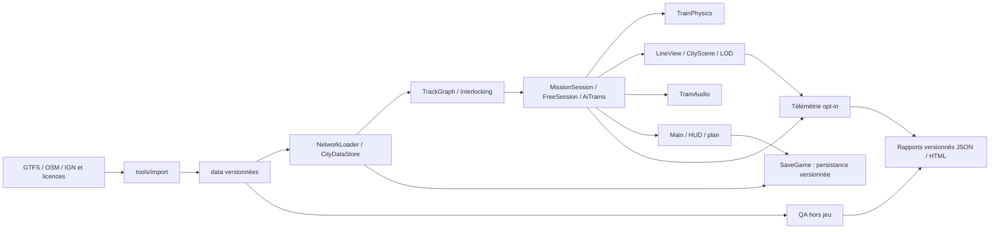

# Contrats et dépendances — fondations P0

SaveGame conserve `load_data -> Dictionary`, `save_data -> bool`, `store_free` et
`add_result`. Les nouvelles erreurs sont explicites, aucune conversion d'une version
future en un fichier neuf. La reprise de graphe ne modifie pas la géographie ; en cas
d'ambiguïté elle échoue en conservant le checkpoint.

QA est hors runtime : lecture des sources, aucune correction silencieuse des réseaux.
Un constat a un ID déterministe, classe, sévérité, coordonnées/repère, preuves,
incertitude et statut. Une exclusion doit avoir une justification et une portée bornée.
Les résultats de rendu/clearance natifs restent distincts des vérifications statiques.

Télémétrie : activée explicitement, bornée, locale/hors ligne. Aucune progression de
jeu modifiée par le parcours de benchmark. Chaque session identifie build, appareil,
backend et scénario. GPU, température, énergie indisponibles : `null` avec motif,
jamais zéro inventé. Les budgets sont des objectifs configurés, pas des mesures.

Format des rapports : `schema_version`, `kind`, `revision`, `scope`, `configuration`,
`measurements`, `findings`, `limitations`. Durées en secondes/ms explicites, distances
en mètres et système de coordonnées documenté. Comparaison uniquement à scénario,
source et configuration compatibles. Les tests injectés ne sont pas des mesures
Android physiques.
