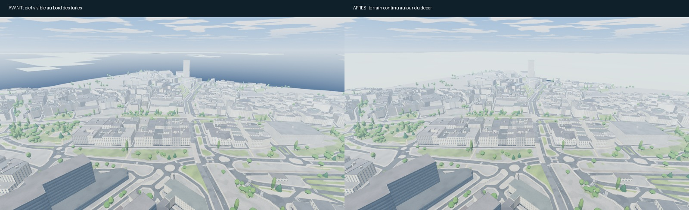
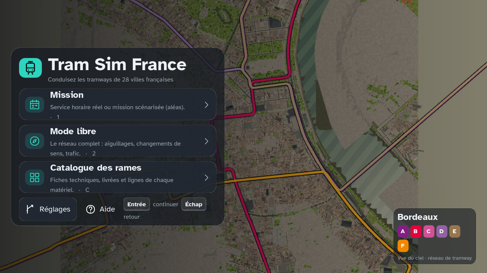
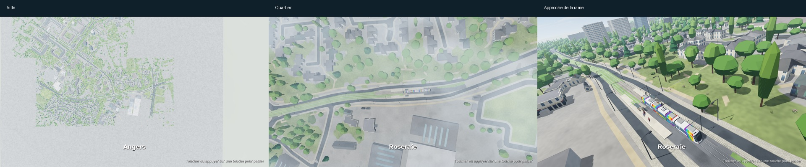

# Cartes, accueil et départs libres — 0.12.1

Les rames et la refonte 0.12 de Claude ont été fusionnées dans `ccr-73402276-ntwr5h` (PR #3, commit `87730e9`). Cette correction part de cette base commune.

## Défauts trouvés et corrections

- Le terrain lointain supprimait une cellule de 250 m dès que son centre tombait dans une tuile de 400 m *présente dans les fichiers*, même si elle n’était pas encore affichée. Le ciel restait visible. Les cellules font maintenant 200 m, s’alignent sur les tuiles et ne disparaissent que sous les tuiles effectivement affichées. Leurs arêtes reprennent les altitudes détaillées. Le fond est rétabli lors du déchargement d’une tuile.
- Une ouverture de tunnel supprimait tout triangle dont le centre tombait dans son emprise. Un triangle pouvait couvrir plusieurs milliers de mètres carrés. Le sol, les trottoirs, bordures et marquages sont désormais découpés suivant l’ouverture réelle, en conservant le relief interpolé. Les faces du sol sont orientées vers le haut.
- Le stockage des deltas d’altitude sur 16 bits débordait sur les reliefs : cinq tuiles à Grenoble et une au Havre produisaient des ruptures multiples de 655,36 m. Le format TGR2 utilise des deltas 32 bits ; le lecteur conserve la prise en charge des anciens TGR1. Les données concernées sont restaurées avec le MNT IGN comme référence.
- Des valeurs littorales anormales dans le MNT et certaines altitudes de surfaces d’eau creusaient le sol. Les anomalies sous −20 m sont traitées comme données manquantes pour ce MNT de surface de France métropolitaine. Les tuiles concernées à Brest, au Havre, à Nantes et à Nice ont été reprises avec les données IGN. La topologie, les matériaux, les bâtiments et les tabliers restent ceux de Claude.

[Audit des 28 villes et 11 168 tuiles](ground-audit.json) · [Détail des réparations](ground-repairs.json)

L’audit vérifie indices, valeurs finies, emprise, couverture et raccords des tuiles. Tolérances : 3 cm aux raccords, 0,5 m² d’écart de couverture sur une tuile de 160 000 m² pour la quantification au 1/64 m. Il ne certifie pas à lui seul chaque détail architectural ou géographique.

## Captures à Nantes

Même pose et même éclairage, avant et après, sans retouche ; WebP sans perte. La comparaison ci-dessous réduit les captures pour les juxtaposer.



| Point | Avant | Après |
|---|---|---|
| Commerce | [Capture](before/Commerce.webp) | [Capture](after/Commerce.webp) |
| Beaujoire | [Capture](before/Beaujoire.webp) | [Capture](after/Beaujoire.webp) |
| Haluchère–Batignolles | [Capture](before/Haluchère%20-%20Batignolles.webp) | [Capture](after/Haluchère%20-%20Batignolles.webp) |

## Accueil et conduite libre

L’accueil présente une vue verticale orthographique, nord en haut, sans brume liée à la hauteur de la caméra. Les tram-trains ne déplacent pas le centre de la vue hors du cœur du réseau urbain. La vue fixe est mise en cache ; un changement de ville ou un lancement de partie annule le chargement précédent par lots, sans attendre toute la ville. Le terrain lointain est préparé une seule fois après le préchargement.

La transition descend par trois paliers, d’une vue verticale de la ville jusqu’à la rame, avec ralentissements et voiles nuageux. Elle reste désactivable et peut être passée au toucher ou au clavier.





Le départ libre suit **Ville → Ligne → Arrêt**, avec une entrée **Dépôts** dans les lignes, puis le choix du dépôt. Le filtre porte sur le lieu de départ ; la conduite conserve l’accès au réseau physique complet.

À Nantes : lignes 1, 2, 3, **TER T1 Nantes–Châteaubriant (11 arrêts)**, **TER T2 Nantes–Clisson (8 gares)** et quatre dépôts. T2 dessert Nantes, Saint-Sébastien Pas Enchantés, Saint-Sébastien Frêne Rond, Vertou, La Haie-Fouassière, Le Pallet, Gorges et Clisson. Les arrêts sont projetés depuis les nœuds des relations OSM sur les voies OSM déjà livrées. Les tram-trains sont proposés en mode libre ; aucun horaire commercial n’est inventé.

Sources : [Nantes–Clisson, relation 19513724](https://www.openstreetmap.org/relation/19513724), [Nantes–Châteaubriant, relation 19515572](https://www.openstreetmap.org/relation/19515572), [coordonnées et provenance](../../data/sources/nantes_tram_train.json). OSM © contributeurs, ODbL ; relief IGN RGE ALTI, Licence Ouverte 2.0.

## Vérification reproductible

```sh
GODOT=godot PYTHON=python3 tests/run_all.sh
python3 tools/qa/audit_ground.py .cache/ground-audit.json
```

Les nouveaux contrôles couvrent le chargement/déchargement du terrain, la découpe d’une ouverture à l’intérieur d’un grand triangle, les altitudes 32 bits, les valeurs littorales invalides, les listes de départ de toutes les villes et le parcours de sélection à Nantes. Le test graphique de l’accueil vérifie aussi la projection orthographique.
