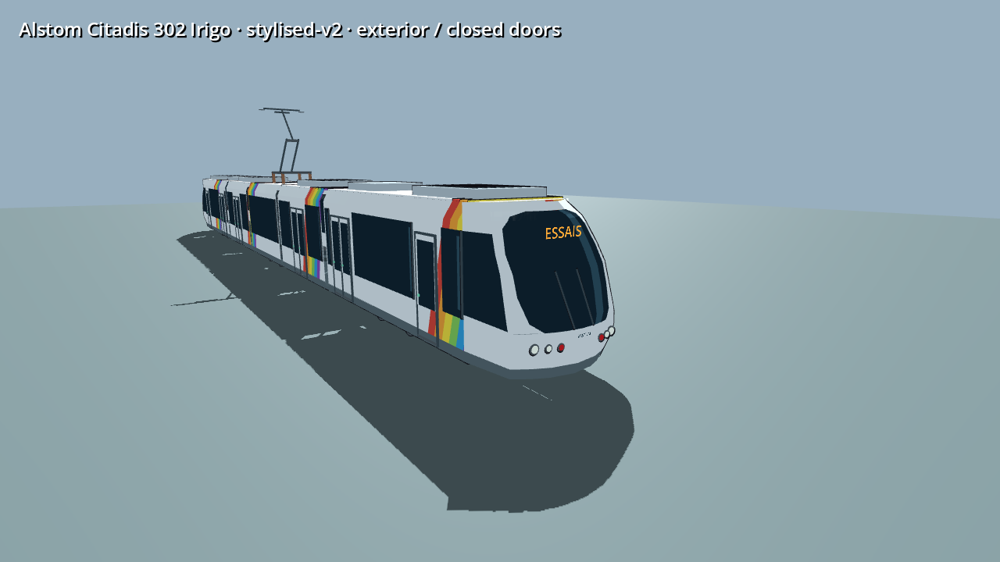
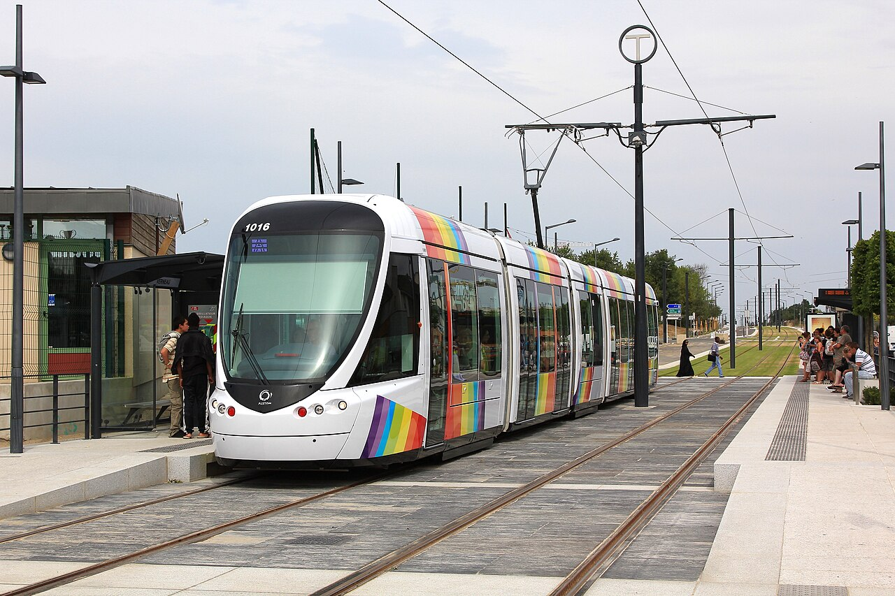
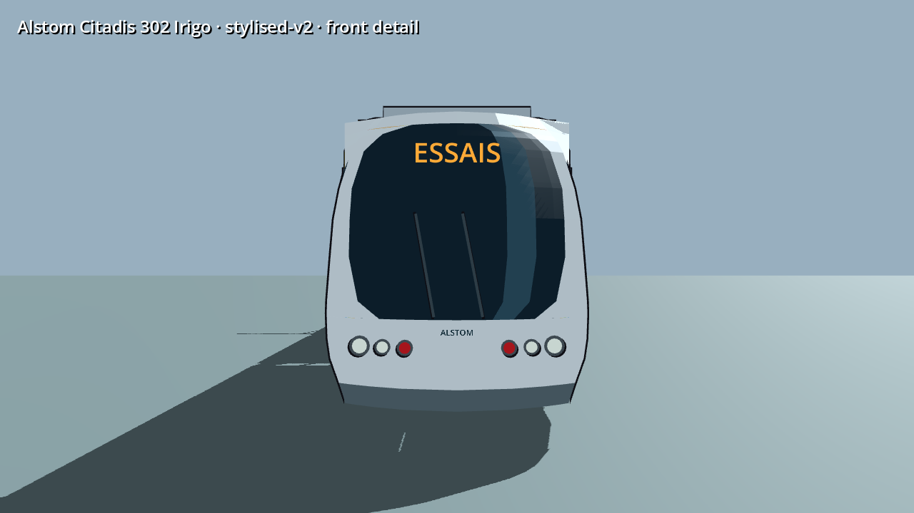
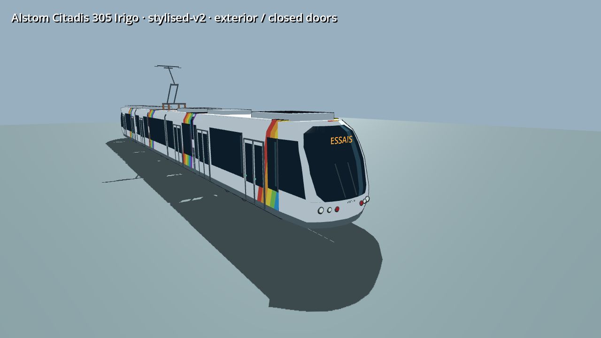
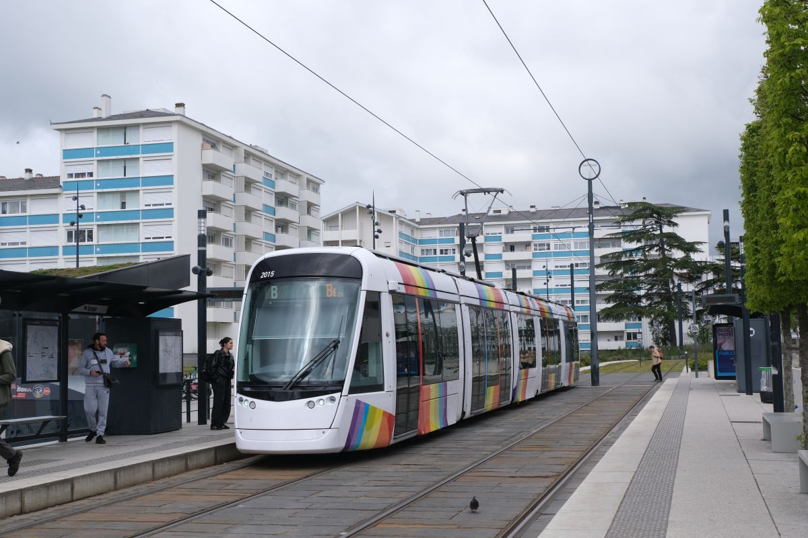
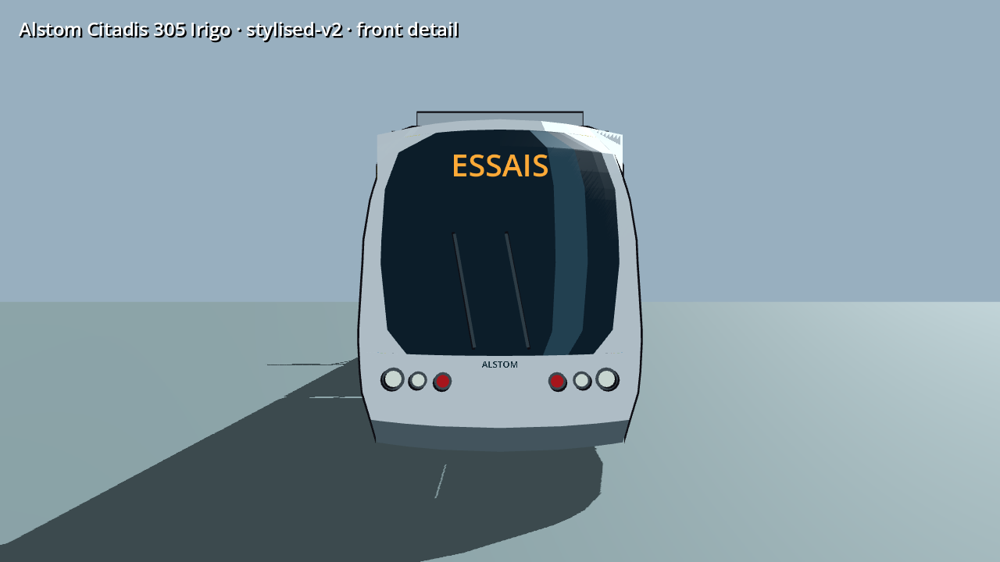
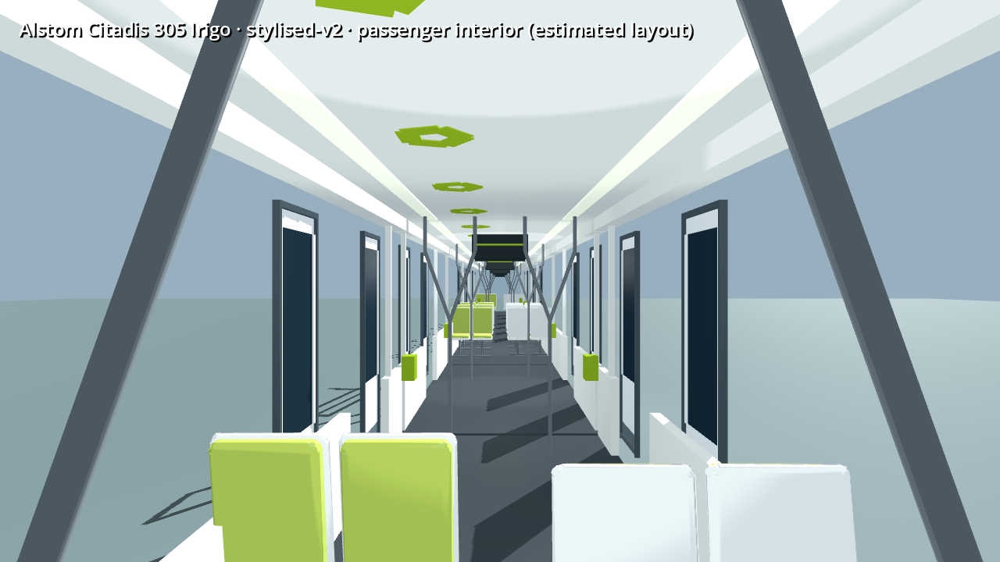
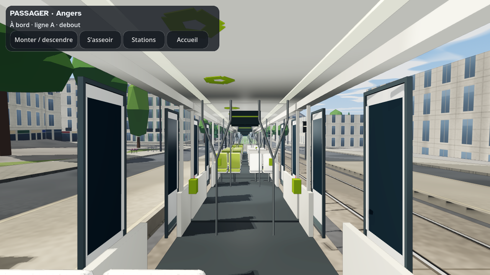

# Citadis Angers / Nantes — version stylisée corrigée

La V1 mélangeait une caisse Meshy aux textures photographiques avec des portes,
un toit et des équipements de l'ancien modèle. Ce rendu est **rejeté**.
La V2 remplace tout le maillage visible de chaque rame par un ensemble cohérent :
caisses, vitrages, livrée, portes, bogies, toiture, soufflets et pantographe.
Les nouveaux modèles sont activés sur cette branche, sans fusion dans la principale.

## Ce qui a changé

- Suppression complète de `MechanicalScaffold` et des morceaux de coque historique.
  Chaque pièce est remplacée avant que la rame entre dans la scène.
- Aucun placage photographique, aucune texture d'éclairage précalculé : couleurs
  de sommets, bandes géométriques, fenêtres séparées et reflets stylisés.
- Une surface et un matériau de palette par pièce ; cel-shading et contour du jeu,
  même exposition que les rames existantes, intérieur également harmonisé.
- Faces avant reconstruites, cabines arrière réellement symétriques, livrées Irigo
  et Naolib, girouettes, essuie-glaces, groupes optiques et bandeau nantais.
- Portes et pantographe : nouveaux maillages ; mêmes transformations et durées
  d'animation. Les modules et l'intérieur suivent toujours la courbure de la voie.
- Ensemble validé avant remplacement : si une pièce manque, toute la rame reste
  sur son ancien modèle. Aucun assemblage partiel entre générations.
- Environ **3,2 Mo** pour les six GLB, contre 13,8 Mo en V1 ; moins de 12 000
  triangles par extérieur complet, LOD Godot conservés. Ces chiffres ne sont pas
  une mesure de FPS sur téléphone.

Les trois générations Meshy d'origine ne sont **pas** présentées comme des modèles
stylisés réussis. Les caisses V2 sont reconstruites **localement dans Blender**, à
partir de l'étude des références et d'un échantillonnage des contours Meshy (10 %
du profil de largeur, contraint à 90 % par le profil choisi depuis les références).
Aucun triangle de leurs caisses brutes ni aucune de leurs textures n'est conservé.
Les sièges gardent leur géométrie Meshy, optimisée et recolorée. Aucune nouvelle
requête payante : **0 crédit supplémentaire**, 90 crédits utilisés au premier lot.

## Captures réelles de Godot

Même atelier, mêmes réglages et même caméra pour l'ancien modèle du jeu et la V2.
Les photos réelles ont leur propre cadrage. Le seul rendu V1 conservé ci-dessous
sert à identifier le résultat rejeté ; son ancien cadrage est différent.
Les anciennes URL `meshy-experimental-*.png` affichent désormais la V2 pour éviter
que les liens déjà partagés continuent à montrer les défauts corrigés.

### Angers — Citadis 302

| Ancien modèle du jeu | Nouveau modèle stylisé | Photo réelle |
|---|---|---|
|  |  |  |



[Animation 302 : portes, pantographe et articulation](angers302-animation.mp4).


### Angers — Citadis 305

| Ancien modèle du jeu | Nouveau modèle stylisé | Photo réelle |
|---|---|---|
|  |  |  |



[Vidéo Godot : portes, pantographe et articulation — 8 secondes](angers305-animation.mp4).
Ce sont 64 images du vrai rig animé, pas une interpolation de captures statiques.
La courbe de l'atelier est démonstrative ; elle ne prétend pas représenter une voie
réelle d'Angers.



### Nantes — Citadis 405

| Ancien modèle du jeu | Nouveau modèle stylisé | Photo réelle |
|---|---|---|
|  |  |  |


[Animation 405 : portes, pantographe et articulation](nantes405-animation.mp4).


### En situation / archive du défaut



[Rendu V1 rejeté, conservé pour comparaison](captures/rejected-angers305-front.png).

## Références, provenance et limites

| Rame | Images étudiées | Planche libre |
|---|---:|---|
| Angers Citadis 302 | 28, dont intérieurs | [Planche](angers_302-references.jpg) |
| Angers Citadis 305 | 11, dont intérieur du dossier d'inauguration 2023 p. 14 | [Planche](angers_305-references.jpg) |
| Nantes Citadis 405 | 13, dont photos officielles de l'intérieur | [Planche](nantes_405-references.jpg) |

Photos des tableaux : 302 — Cramos, Commons 28980217, CC BY-SA 3.0 ;
305 — Blauer Pfeil, Commons 188202395, CC BY-SA 4.0 ;
405 — Smiley.toerist, Commons 200396066, CC BY-SA 4.0.
Le registre donne les pages, auteurs et licences complets. Les planches n'incluent
que les images Commons réutilisables. Les photos institutionnelles réservées ont
été étudiées localement et n'ont été ni redistribuées ni envoyées à Meshy.

- [Registre des références et exclusions](../../data/rolling_stock/meshy_sources/references.json)
- [Attributions et licences](../../data/rolling_stock/meshy_sources/CREDITS.md)
- [Tâches Meshy d'origine et consommation](../../data/rolling_stock/meshy_sources/tasks.json)
- [Origine exacte de la reconstruction V2](../../data/rolling_stock/meshy_sources/reconstruction.json)
- [Empreintes, tailles, triangles et surfaces](../../data/rolling_stock/meshy_sources/assets.json)
- [Résultats de validation](validation.json)

Les proportions, les fenêtres et les aménagements restent estimés à partir des
photos et des plans du jeu ; ce ne sont pas des relevés constructeur. Le poste de
conduite détaillé reste à compléter. Le modèle est stylisé, pas une reproduction
photogrammétrique certifiée. Le scénario passager, l'ouverture des deux côtés,
le pantographe et les vingt familles d'intérieur ont été vérifiés ; performances
Android, rendu Vulkan et nouveaux exports APK/EXE non validés localement.

## Reproduire

```sh
# Reconstruction des caisses : Blender, sans API, à partir des profils enregistrés.
blender -b --python tools/rolling_stock/retopologize_citadis.py
# Reconstruction complète, sièges inclus : nécessite les GLB sources conservés
# dans meshy_output/ ou retéléchargés depuis les ID de tâches enregistrés.
blender -b --python tools/rolling_stock/prepare_meshy_citadis.py

godot --headless --editor --path . --import
python tools/rolling_stock/audit_citadis.py --write-manifest
python tools/rolling_stock/audit_citadis.py
godot --headless --path . --script tests/test_citadis_meshy.gd
godot --headless --path . --script tests/test_rolling_stock.gd
godot --headless --path . --script tests/test_passenger_families.gd
godot --headless --path . --script tests/test_passenger_mode.gd

# Atelier comparatif sur un affichage OpenGL :
godot --path . --rendering-method gl_compatibility --audio-driver Dummy \
  --script tools/rolling_stock/review_citadis.gd
# Anciennes rames complètes, uniquement pour comparaison A/B en jeu :
TRAMSIM_CITADIS_LEGACY=1 godot --path .
# Images d'animation du 305 :
TRAMSIM_REVIEW_ANIMATION=1 TRAMSIM_REVIEW_ONLY_V2=1 \
TRAMSIM_REVIEW_VARIANT=angers__citadis_x05 godot --path . \
  --rendering-method gl_compatibility --audio-driver Dummy \
  --script tools/rolling_stock/review_citadis.gd
ffmpeg -y -framerate 8 -i .cache/citadis-v2/animation/angers305/%03d.png \
  -vf scale=960:-2 -c:v libx264 -crf 22 -pix_fmt yuv420p -movflags +faststart \
  docs/rolling-stock-meshy/angers305-animation.mp4
```

Le contrôle CI vérifie provenance, empreintes, absence de textures dans les GLB,
une surface par pièce, animations et régressions. Le contrôle de rendu sous Xvfb,
quand disponible, détecte notamment le bug de matériau noir ; il ne constitue pas
un score de réalisme. Les captures locales proviennent de Godot 4.6.3,
OpenGL Compatibility / Mesa llvmpipe.
