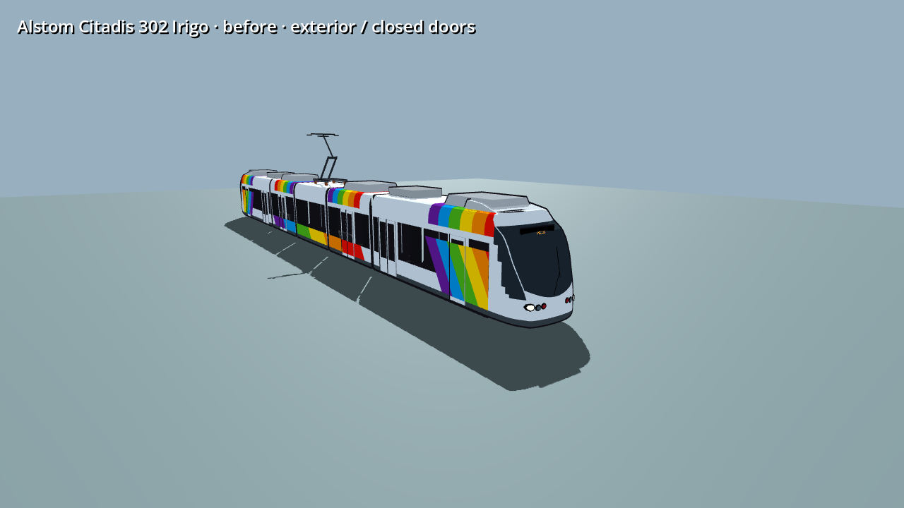
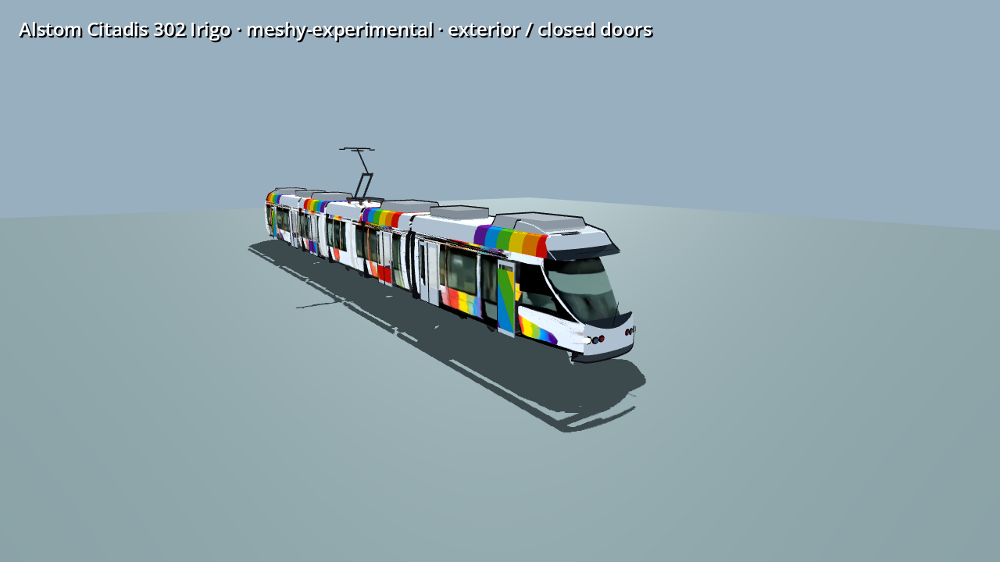
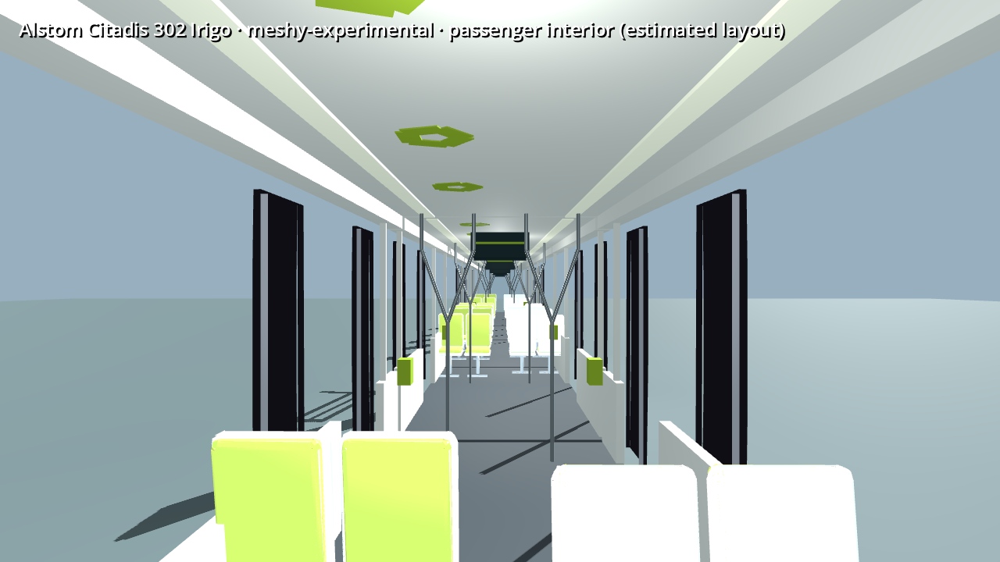
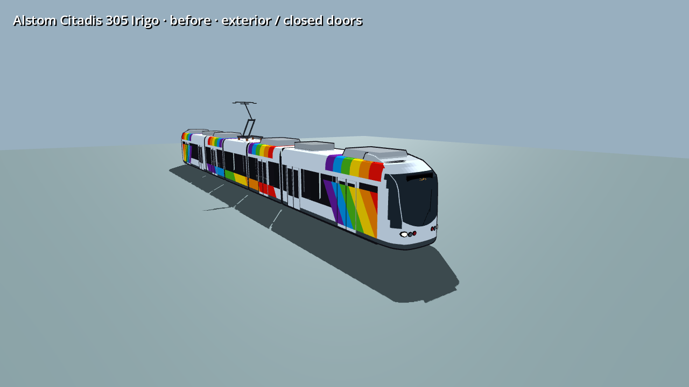
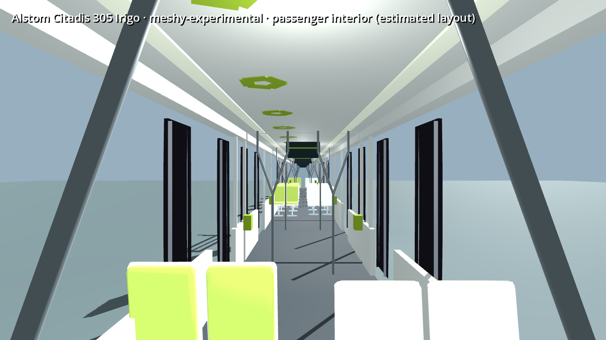
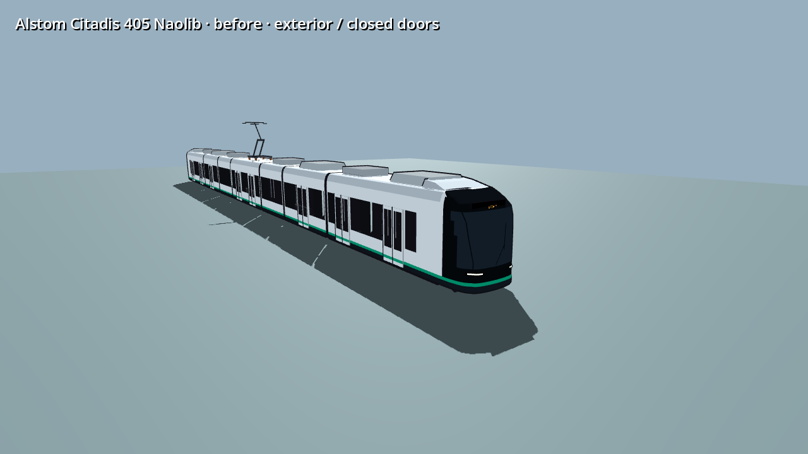
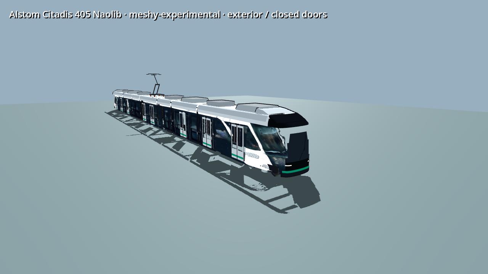
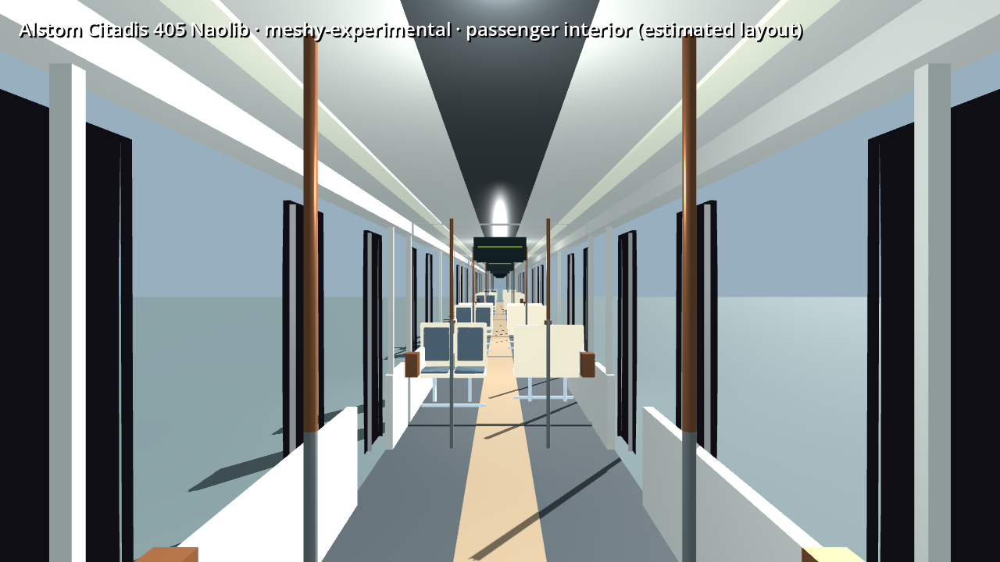
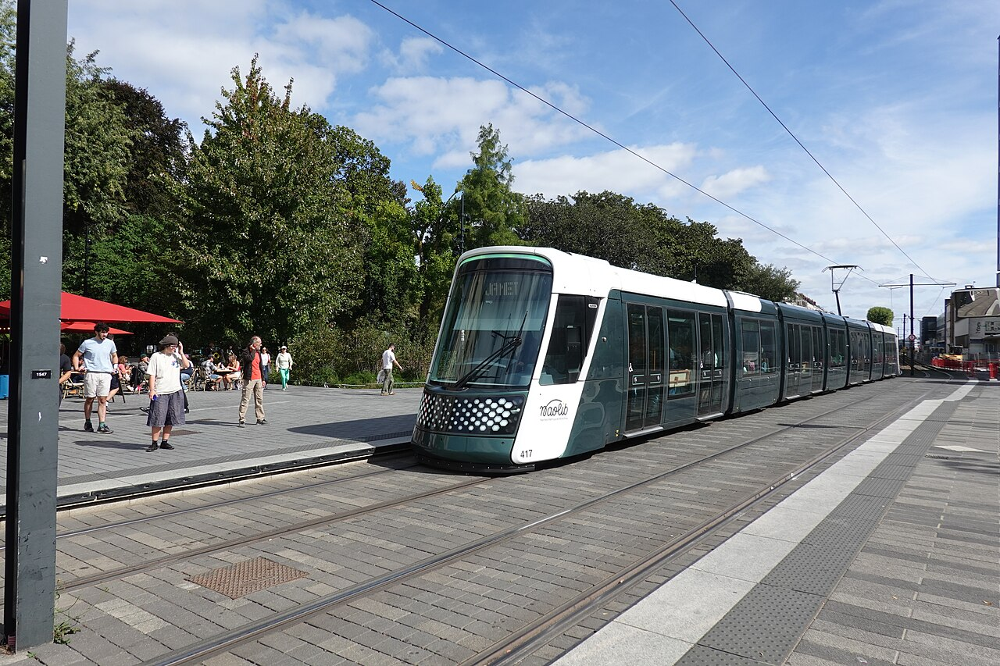

# Citadis Angers / Nantes — atelier Meshy

Branche dédiée, issue de `codex/rust-weather-passenger` (02aa953). Aucune modification
des cartes de Claude, aucune fusion ni release. Générations réelles du 20 novembre
2026 : **6 géométries, 6 texturages, 90 crédits Meshy confirmés**, sans achat ni relance.
Les trois opérations de retexturage extérieur s'ajoutent aux trois créations
géométriques ; les créations de sièges incluent directement leur texturage.

## Résultat et limites

- **Intérieurs intégrés** : sièges Meshy optimisés, couloir, vestibules libres,
  éclairages, écrans, cloisons, barres tulipes et motif végétal à Angers ; sièges
  à coques bois, sol bicolore et barres cuivrées à Nantes. Assemblage local,
  disposition estimée depuis les photos, pas de relevé constructeur ni de capacité
  d'assise certifiée. Le poste de conduite détaillé reste à refaire.
- **Extérieurs en aperçu expérimental** : cinq / cinq / sept modules séparés,
  portes du rig conservées, pantographe, toiture mécanique et bogies historiques
  conservés. Textures IA encore bruitées, panneaux déformés, positions de certaines
  portes peintes incohérentes, arrières extrapolés et faces avant à retopologiser.
  Ils restent désactivés par défaut pour préserver la qualité de l'existant.
- Shader partagé utilisant les paliers cel-shading du jeu. Pas d'IA au runtime.
  Les sièges sont regroupés en MultiMesh ; intérieurs créés à l'embarquement.
  LOD Godot activés, textures de caisse embarquées compressées Basis Universal.
- Autres villes et rame fictive 405 Irigo inchangées. Repli sur les intérieurs
  génériques si le kit demandé manque.

**La remodélisation complète fidèle n'est donc pas terminée.** Ce lot livre des
assets inspectables, une intégration d'intérieur et un adaptateur mécanique ;
il ne valide pas les caisses IA comme remplacements finaux.

## Références réellement étudiées

| Rame | Images | Intérieur | Planche libre |
|---|---:|---|---|
| Angers Citadis 302 | 28 | Vert / motifs végétaux / barres tulipes | [Planche](angers_302-references.jpg) |
| Angers Citadis 305 | 11 | Photo du dossier d'inauguration 2023, p. 14 | [Planche](angers_305-references.jpg) |
| Nantes Citadis 405 | 13 | Photos officielles Patrick Garçon, sièges / barres / cabine | [Planche](nantes_405-references.jpg) |

Les planches n'incluent que les photos Commons réutilisables. Pour le 305, les
deux autres images sont des documents institutionnels consultés localement et
référencés dans le registre. Pas d'envoi de ces images réservées à Meshy.
Les photos de TFS, de dépôt ambigu ou trop éloignées ont été écartées.

Le Smart Topology n'accepte qu'une image pour la géométrie. Trois vues sont
utilisées pour chaque retexturage extérieur N1 ; les autres photos servent à
l'étude, au contrôle et aux aménagements. Il serait faux de dire que les dix
photos ont toutes été injectées dans une même génération.

[Registre complet, auteurs, licences, SHA-256](../../data/rolling_stock/meshy_sources/references.json)
· [Attributions](../../data/rolling_stock/meshy_sources/CREDITS.md)
· [Tâches et consommation réelle](../../data/rolling_stock/meshy_sources/tasks.json)
· [Taille et triangles des six assets](../../data/rolling_stock/meshy_sources/assets.json)

## Captures Godot avant / prototype / photo réelle

Ces images sont des captures Godot 4.6.3 / OpenGL Compatibility, dans un atelier
neutre ; pas des rendus publicitaires Meshy. Les photos ne sont pas des captures
du jeu. Tous les fichiers `captures/` se régénèrent avec la commande ci-dessous.

| Rame | Avant | Caisse Meshy expérimentale | Nouvel intérieur | Photo réelle |
|---|---|---|---|---|
| 302 Angers |  |  |  |  |
| 305 Angers |  |  |  |  |
| 405 Nantes |  |  |  |  |

Photos : 302 — Cramos, Commons 28980217, CC BY-SA 3.0 ; 305 — Blauer Pfeil,
Commons 188202395, CC BY-SA 4.0 ;
405 — Smiley.toerist, Commons 200396066, CC BY-SA 4.0.
Les licences et liens complets du registre priment sur les abréviations de légende.

Capture d'embarquement réelle sur le réseau d'Angers (ancien extérieur préservé,
nouvel intérieur activé) :


## Reproduire et tester

```sh
godot --headless --editor --path . --import
python tools/rolling_stock/audit_citadis.py
godot --headless --path . --script tests/test_citadis_meshy.gd
godot --headless --path . --script tests/test_rolling_stock.gd
godot --headless --path . --script tests/test_passenger_families.gd
godot --headless --path . --script tests/test_passenger_mode.gd
# Avec un affichage OpenGL :
godot --path . --rendering-method gl_compatibility --audio-driver Dummy \
  --script tools/rolling_stock/review_citadis.gd
# Pour inspecter les caisses expérimentales en conduite (pas activation par défaut) :
TRAMSIM_MESHY_PREVIEW=1 godot --path .
```

Pour refaire les entrées originales des sièges, Blender est nécessaire :
`blender -b --python tools/rolling_stock/render_seat_references.py`.
Le script produit des formes de travail, pas des images authentiques du matériel.
Il ne lance aucune génération payante. Les trois PNG envoyés à Meshy sont conservés
dans `data/rolling_stock/meshy_sources/inputs/` avec leurs empreintes.

Les tâches sont à retrouver par leur ID, sans en créer d'autres :

```sh
meshy image-to-3d get ID --format json --no-update-check -o meshy_output/COMPOSANT --workspace meshy_output
# Pour les trois tâches de retexturage : même commande avec « retexture get ».
```

Les métadonnées brutes contiennent des URL temporaires : `meshy_output/` reste
ignoré par Git et Godot. `audit_citadis.py --download-references` recharge seulement
les photos Commons autorisées, vérifie leur empreinte et ne télécharge pas les
sources à droits réservés. Aucun serveur MCP supplémentaire n'est nécessaire.

## Vérifications et suite nécessaire

Tests locaux : import Godot, chargement des six GLB, sélection exacte des variantes,
positions des modules, absence de triangles entre deux caisses, portes indépendantes
gauche / droite, fermeture, pantographe haut / bas, suivi de l'articulation par les
intérieurs, sièges hors vestibule, batching et repli d'asset absent. Tests historiques
de matériel roulant, des 20 familles d'intérieur et d'embarquement également exécutés.
La CI `citadis-meshy` répète les contrôles de provenance et les tests de rig.
[Résultats locaux structurés](validation.json) : 229 contrôles du nouveau rig,
301 contrôles historiques avant et après, 20 familles intérieures et 24 contrôles
d’embarquement avec capture du véritable jeu.

Non validés : performance sur téléphone, rendu Vulkan, export APK/EXE de ce lot,
finesse perceptive et conformité de chaque détail à chaque rame réelle. Le rendu
local utilise llvmpipe, donc ne fournit pas une mesure de FPS mobile.

Avant activation des caisses : retopologie manuelle des faces et arrière,
reconstruction propre des panneaux/baies, UV et livrées sans éclairage photographique,
alignement des portes peintes avec les plans mécaniques, détails cabine, LOD contrôlés
sur appareil réel et revue visuelle comparative. Aucune nouvelle génération payante
n'est lancée automatiquement pour masquer ces défauts.
